<!-- Arte de terminal baseada no modelo de referência fornecido, com dados reais atualizados diariamente. -->

<h3><code>leticia@github ~ $ ./contributions.sh</code></h3>

 
 

<h3><code>leticia@github ~ $ whoami</code></h3>

<table>
<tr>
<td valign="top"></td>
<td valign="top"></td>
</tr>
</table>

 
 

<h3><code>leticia@github ~ $ ./links.sh</code></h3>

<b>Desenvolvedora de Sistemas &amp; Web · Dados &amp; Automação · Engenharia Industrial</b>

Tecnologia, dados e engenharia conectados para transformar processos.

Graduada em Análise e Desenvolvimento de Sistemas · Pós-graduanda em Engenharia de Controle e Automação · Mechanical Designer

 

